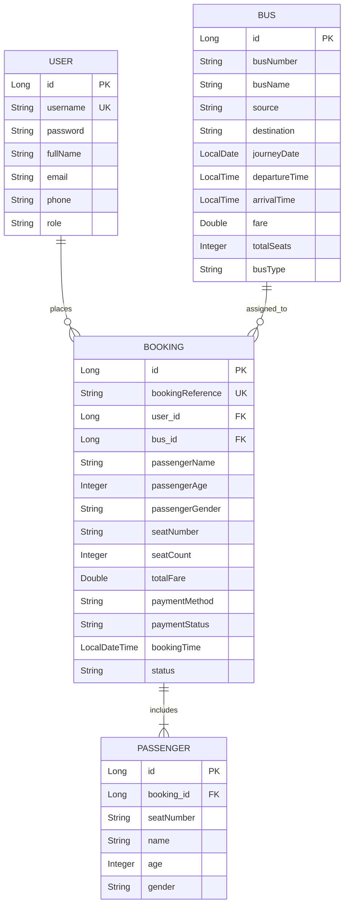

# PROJECT REPORT: ONLINE BUS TICKET BOOKING SYSTEM

---

## 1. EXECUTIVE SUMMARY

The **Bus Ticket Booking System (BusGo)** is an enterprise-grade web application developed in **Java 21** using **Spring Boot**, **Jakarta Servlets**, **Spring Data JPA**, **H2 Database**, **Thymeleaf**, and **OpenPDF**. The system delivers an end-to-end seat reservation platform featuring interactive bus cabin seat grids, dynamic per-seat multi-passenger input forms, UPI QR code payment simulation, automated downloadable PDF boarding passes with digital barcodes, a public PNR verification portal, and an Admin Management Console for tracking fleet occupancy and passenger manifests.

---

## 2. PROJECT OBJECTIVES

* Provide an intuitive web interface for browsing and filtering bus routes by origin, destination, and journey date.
* Enable visual, interactive seat reservation with real-time feedback (available, booked, selected).
* Allow multiple seat selection under a single account with distinct passenger details (Name, Age, Gender) per seat.
* Integrate a real-world UPI QR payment checkout workflow.
* Generate official, downloadable PDF confirmation tickets with unique PNRs, trip details, and barcode verification.
* Provide role-based access for regular travelers and administrators.
* Empower administrators with live occupancy progress metrics, revenue analytics, and printable passenger rosters.

---

## 3. SYSTEM ARCHITECTURE & TECHNOLOGY STACK

```
+-------------------------------------------------------------------+
|                        CLIENT BROWSER                             |
|        (HTML5, TailwindCSS, FontAwesome, JavaScript DOM)          |
+---------------------------------+---------------------------------+
                                  | HTTP Requests / Responses (Port 8080)
                                  v
+-------------------------------------------------------------------+
|               EMBEDDED APACHE TOMCAT SERVLET CONTAINER             |
|                                                                   |
|   +-----------------------------------------------------------+   |
|   |                  Jakarta DispatcherServlet                |   |
|   +-----------------------------+-----------------------------+   |
|                                 |                                 |
|                                 v                                 |
|   +-----------------------------------------------------------+   |
|   |         Spring MVC Controller (BusBookingController)      |   |
|   |      - Handles /login, /buses, /book, /ticket-pdf         |   |
|   |      - Manages HttpSession & HttpServletRequest           |   |
|   +--------------+-----------------------------+--------------+   |
|                  |                             |                  |
|                  v                             v                  |
|   +------------------------------+   +------------------------+   |
|   |   Business Services Layer    |   |     View Templates     |   |
|   |   - PdfTicketService (OpenPDF|   |   - Thymeleaf Engine   |   |
|   |   - BookingService           |   |   - Responsive HTML5   |   |
|   +--------------+---------------+   +------------------------+   |
|                  |                                                |
|                  v                                                |
|   +-----------------------------------------------------------+   |
|   |            Spring Data JPA / Hibernate ORM Layer          |   |
|   |     (UserRepository, BusRepository, BookingRepository)    |   |
|   +-----------------------------+-----------------------------+   |
|                                 |                                 |
|                                 v                                 |
|   +-----------------------------------------------------------+   |
|   |            Embedded H2 Relational In-Memory Database      |   |
|   |                   (jdbc:h2:mem:busbookingdb)              |   |
|   +-----------------------------------------------------------+   |
+-------------------------------------------------------------------+
```

### Technology Breakdown:
* **Programming Language:** Java 21 (LTS)
* **Framework:** Spring Boot 3.4.3
* **Servlet Engine:** Apache Tomcat 10.1 (Jakarta Servlet API 6.0)
* **Persistence & ORM:** Spring Data JPA / Hibernate ORM 6.6
* **Database:** Embedded H2 In-Memory Database (zero-configuration)
* **Template Engine:** Thymeleaf 3.1
* **PDF Engine:** OpenPDF 1.3.39 (LibrePDF) with Barcode128 generator
* **Frontend UI:** TailwindCSS, FontAwesome 6, Vanilla JavaScript (ES6)
* **Build Tool:** Apache Maven 3.9+

---

## 4. DATABASE DESIGN & SCHEMA

The database schema consists of four relational entities:

### 4.1. Entity Relationship Diagram (ERD)



---

## 5. KEY MODULES & IMPLEMENTATION DETAILS

### 5.1. Authentication & Session Management
* Role-based access control distinguishing between `ROLE_USER` and `ROLE_ADMIN`.
* Backed by Jakarta Servlet's `HttpSession`. Users can sign in, register a new account, or utilize pre-seeded demo accounts with one-click fill buttons.

### 5.2. Visual Bus Cabin Seat Selection
* Simulates an 8-row, 2x2 cabin layout (32 seats) with driver compartment and central aisle.
* Color-coded statuses:
  - 🟢 **Available:** Green border, clickable.
  - 🟣 **Selected:** Deep indigo background with elevation animation.
  - 🔴 **Booked:** Light red, disabled, unclickable.

### 5.3. Dynamic Per-Seat Multi-Passenger Inputs
* Implemented in JavaScript: selecting multiple seats dynamically creates a dedicated passenger form card for every selected seat.
* The lead passenger auto-populates with the logged-in user's profile details.
* Dynamically updates seat count badges, base fares, and total payable calculations in real-time.

### 5.4. UPI QR Code Payment Gateway Simulation
* Upon proceeding to checkout, a clean modal presents the company's designated **UPI QR Code** (`/images/upi-qr.jpg`) alongside the computed payable amount.
* Supported across UPI apps (Google Pay, PhonePe, Paytm, BHIM).
* Clicking **"Done (Payment Completed)"** finalizes the booking and issues the ticket.

### 5.5. Official PDF Boarding Pass Generator
* Built with OpenPDF in `PdfTicketService.java`.
* Contains:
  - Organization title and Boarding Pass header.
  - PNR Reference and status.
  - Boarding vs. Destination summary box with schedule times.
  - Trip metadata (Bus Operator, Registration Number, Bus Type, Fare Paid, Payment Method).
  - Detailed **Passenger Manifest Table** displaying individual passenger names, ages, and seat numbers.
  - **Code 128 Digital Barcode** for gate terminal validation.
  - Travel instructions and passenger guidelines.

### 5.6. Public Boarding Pass Verification & PNR Search
* Provides an open endpoint `/ticket/verify/{pnr}`.
* Anyone can search their PNR on the homepage or scan their boarding pass to view an authenticated confirmation screen without needing to log in.

### 5.7. Comprehensive Admin Management Portal
* Accessible exclusively via the `admin` account at `/admin/dashboard`.
* Displays real-time KPIs: Active Buses, Confirmed Bookings, and Gross Revenue.
* Fleet Tracker: Shows visual occupancy percentage bars for every bus route.
* **Passenger Manifest:** Clickable roster displaying all booked travelers for any bus schedule.
* Route Manager: Modal form to add or schedule new buses.

---

## 6. PRE-SEEDED DEMO CREDENTIALS

| Account Role | Username | Password | Purpose |
| :--- | :--- | :--- | :--- |
| **Admin** | `admin` | `admin123` | Full dashboard access, view passenger manifests, revenue tracking, route management. |
| **Demo User 1** | `john` | `user123` | Multi-seat booking, download PDF boarding passes, ticket cancellation. |
| **Demo User 2** | `sarah` | `user123` | Standard passenger booking and history viewing. |

---

## 7. HOW TO RUN THE PROJECT LOCALLY

### Prerequisites
* **Java Development Kit (JDK):** Version 21 or higher.
* **Apache Maven:** Version 3.9+ (bundled wrapper `mvnw` also included).

### Starting the Application
Double-click `run.bat` in the project root directory, or open a terminal and execute:
```bash
java -jar target/busbooking-0.0.1-SNAPSHOT.jar
```

Open a web browser and visit:
👉 **`http://localhost:8080`**

### Embedded Database Console
* **URL:** `http://localhost:8080/h2-console`
* **JDBC URL:** `jdbc:h2:mem:busbookingdb`
* **Username:** `sa`
* **Password:** `password`

---

## 8. CONCLUSION & FUTURE ENHANCEMENTS

The project demonstrates the practical application of enterprise Java web technologies, Jakarta Servlets, relational database mapping, and dynamic client-side scripting.

### Potential Future Extensions:
1. Integration with a live SMS / Email API (Twilio / SendGrid) for automated ticket dispatch.
2. Integration with live payment gateway webhooks (Razorpay / Stripe).
3. GPS vehicle live-tracking on an interactive map using Leaflet.js / Google Maps API.
4. Seat pricing tiers (e.g., lower vs. upper sleeper berths).
